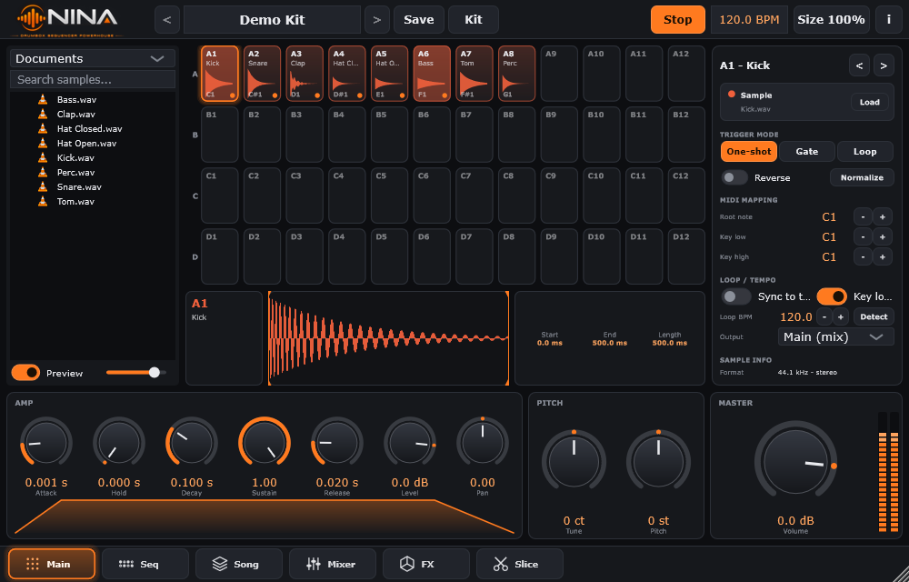
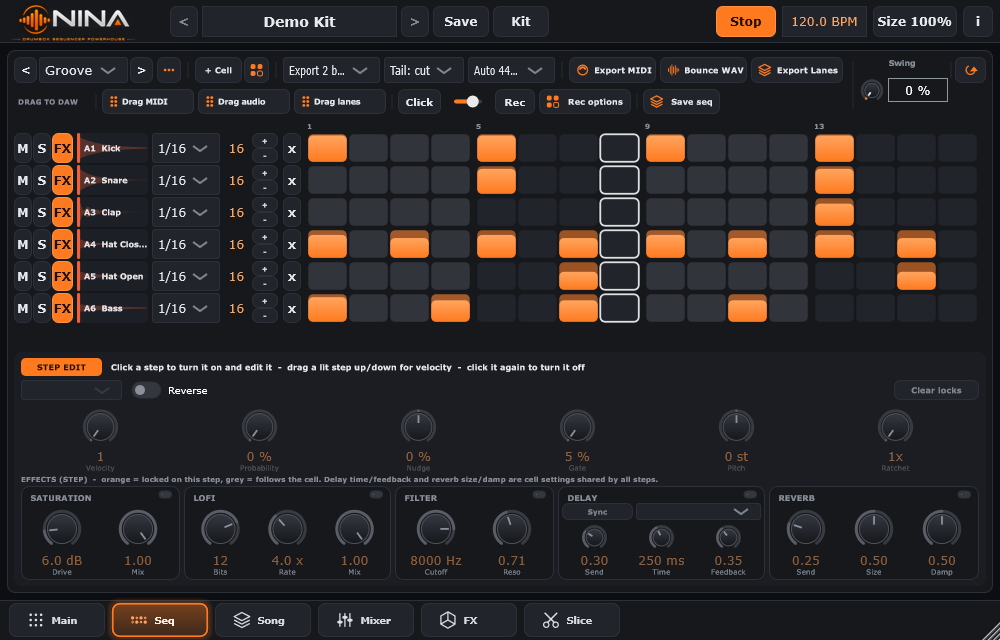
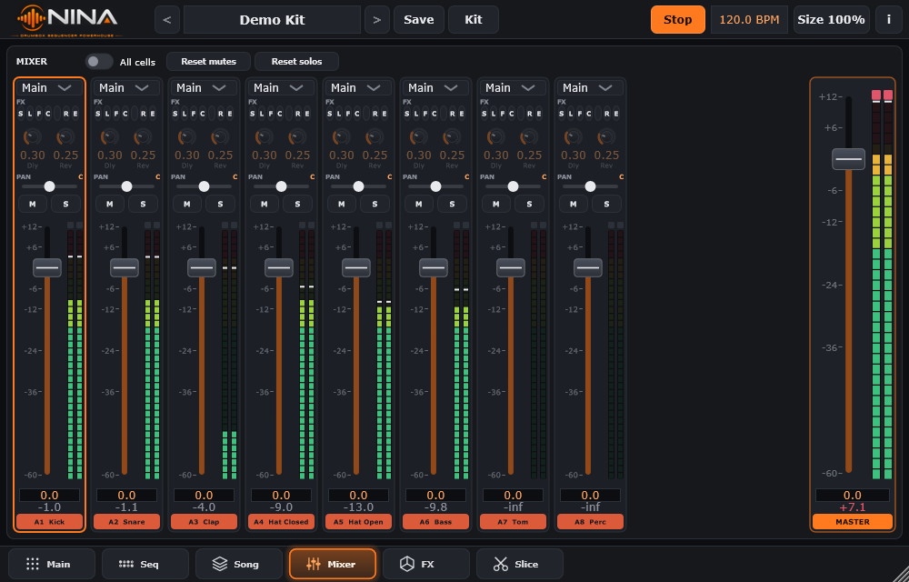
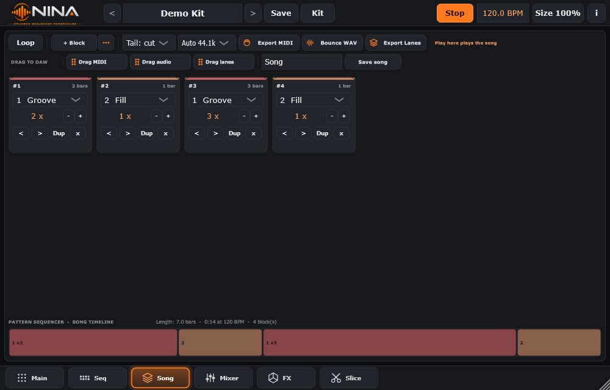
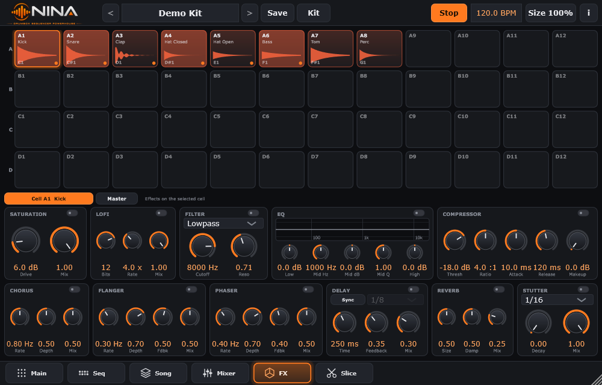
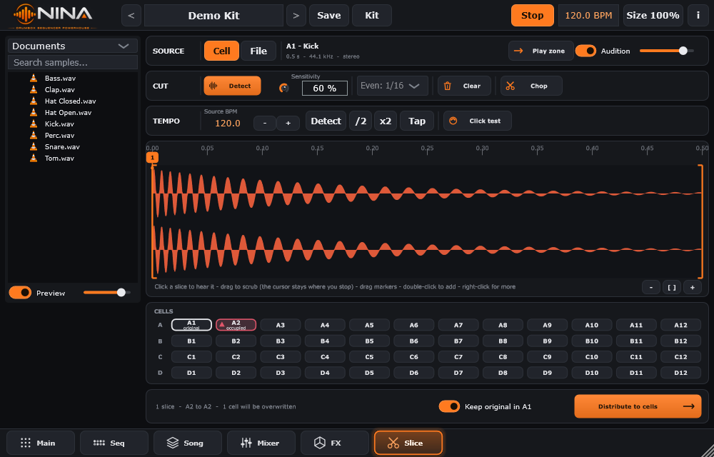

**English** · [Italiano](README.it.md)

# NINA – Drumbox Sequencer Powerhouse

Sampler / drum machine as a **VST3 plug-in** and a **standalone application** for Windows and macOS, inspired by Native Instruments Battery, with a step sequencer. Free software for personal use.

- **User manual:** [docs/manual/README.md](docs/manual/README.md) (getting started, cells, effects, sequencer, kits, automation, exporting). Italian version: [docs/manuale/README.md](docs/manuale/README.md)
- Requirements: [docs/REQUIREMENTS.md](docs/REQUIREMENTS.md)
- Architecture: [docs/ARCHITECTURE.md](docs/ARCHITECTURE.md)

## Screenshots




| Mixer | Song |
|---|---|
|  |  |
|  |  |

*Demo kit with synthetic sounds, generated by the app itself.*

## Download

From the latest [Release](https://github.com/muttleysat/NINA/releases/latest): `NINA-Setup-<version>-win-x64.exe` (Standalone with ASIO, VST3, manual) for Windows, and `NINA-<version>-mac-universal.dmg` (Standalone, VST3, Audio Unit; Intel + Apple Silicon) for macOS.

### macOS installation

The macOS build is **not signed or notarized** (free project, no Apple Developer account), so Gatekeeper blocks it on first launch.

1. Open the `.dmg` and copy `NINA.app` to `/Applications`, `NINA.vst3` to `~/Library/Audio/Plug-Ins/VST3` and `NINA.component` to `~/Library/Audio/Plug-Ins/Components`.
2. Remove the quarantine flag (once):
   ```bash
   xattr -cr /Applications/NINA.app ~/Library/Audio/Plug-Ins/VST3/NINA.vst3 ~/Library/Audio/Plug-Ins/Components/NINA.component
   ```
   Alternatively, try to open the app, then go to System Settings > Privacy & Security > **Open Anyway**.
3. Restart your DAW and rescan plug-ins.

## Build (macOS)

Requires Xcode and CMake (`brew install cmake`). Build **outside** iCloud-synced folders (Documents, Desktop), otherwise code signing fails with "detritus not allowed":

```bash
cmake -S . -B ~/nina-build -G Xcode
cmake --build ~/nina-build --config Release
```

Output in `~/nina-build/Nina_artefacts/Release/` (`Standalone`, `VST3`, `AU`; universal arm64 + x86_64). `installer/build-dmg.sh` creates the `.dmg`; if you have a Developer ID, set `SIGN_ID` and `NOTARY_PROFILE` to sign and notarize it.

## Build (Windows)

```powershell
cmake -S . -B build -G "Visual Studio 17 2022" -A x64
cmake --build build --config Release
```

Output in `build/Nina_artefacts/Release/` (`VST3` and `Standalone` folders).

## Installer (Windows)

`installer\build-installer.ps1` builds `installer\Output\NINA-Setup-<version>-win-x64.exe` with [Inno Setup 6](https://jrsoftware.org/isinfo.php) (`winget install JRSoftware.InnoSetup`). Build the project in Release first. The installer contains the standalone (with ASIO), the VST3 plug-in, the manual and the licences; the Visual C++ runtime is linked statically, so nothing else has to be installed. The version is read from `CMakeLists.txt`. The wizard images are regenerated with `python installer/make_wizard_images.py`.

## Licence

NINA is free software under the **GNU AGPL-3.0** (see the [LICENSE](LICENSE) file); third-party libraries and their acknowledgements are listed in [THIRD_PARTY_NOTICES.md](THIRD_PARTY_NOTICES.md). The NINA name, logo and icon are not covered by the licence of the code. VST is a trademark of Steinberg Media Technologies GmbH.

## ASIO (Windows standalone only)


ASIO drivers need the Steinberg SDK (version **2.3.4 or later**, dual licensed: Steinberg agreement or **GPL 3**, which is the one compatible with NINA). The SDK is not in the repository: download it separately. To enable ASIO:

1. Download the ASIO SDK from <https://www.steinberg.net/asiosdk>.
2. Extract it into `third_party/asiosdk/` (`third_party/asiosdk/common/iasiodrv.h` must exist).
3. Run `cmake -S . -B build ...` again: the configuration prints "ASIO SDK found".

Without the SDK the standalone uses only WASAPI/DirectSound. In the VST3 the audio device is handled by the DAW, so ASIO is not needed. The released installer already includes ASIO support.

## Tests

```powershell
cmake --build build --config Release --target NinaTests
build\NinaTests_artefacts\Release\NinaTests.exe
```

They cover the playback engine (mapping, velocity, level, start/end, pitch, reverse, one-shot/gate/loop, layers, voice stealing) and the kit format (saving with the sample folder of the same name, reloading, missing samples, schema version).

## Status

Version 1.0.0. Main features:

- **Sampler:** 4×12 grid of cells with mapping from C1, file browser, drag & drop onto the pads, cell editor (waveform with Start/End, AHDSR, Level, Pan, Tune, Pitch, one-shot/gate/loop modes, reverse, note range), `.slkit` kits with a sample folder of the same name, open/save/recent kits, resize menu in percentages.
- **Loops and tempo:** per cell **Sync to tempo**, **Key lock** and **Loop BPM** (estimated from the length): the loop follows the BPM of the DAW without changing pitch (Rubber Band). **Slice** tab to cut loops and distribute the slices onto the cells.
- **Effects:** **FX** tab with six effects per cell and for the kit (Saturation, LoFi, Filter, Compressor, Delay, Reverb), each with its switch; delay and reverb keep sounding after the end of the note.
- **Sequencer:** **Seq** tab with one row per added cell (right click on a cell > "Add to sequencer"), steps with velocity, probability, ratchet, nudge, gate, pitch and parameter locks on the effects; MIDI export and WAV bounce. MIDI learn on the parameters (right click on a control) and BPM-synced delay.
- **Song and Mixer:** chain patterns into a song (`.slsong`) and a mixing console with one channel per cell (fader, meter, Mute/Solo, pan, sends, outputs).

Still missing: verification of every feature in Cubase 16 (including the multiple outputs per cell, done in the engine), macOS build (compiled and passing tests, not yet verified in a DAW).
